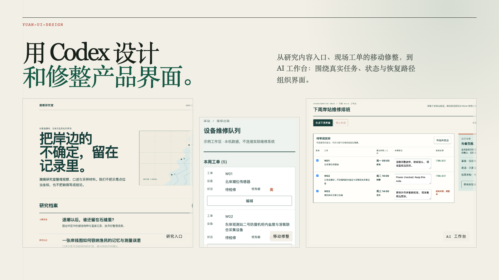
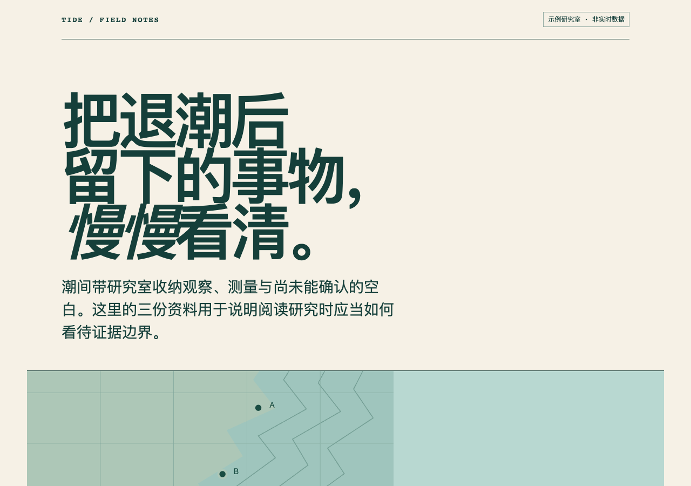
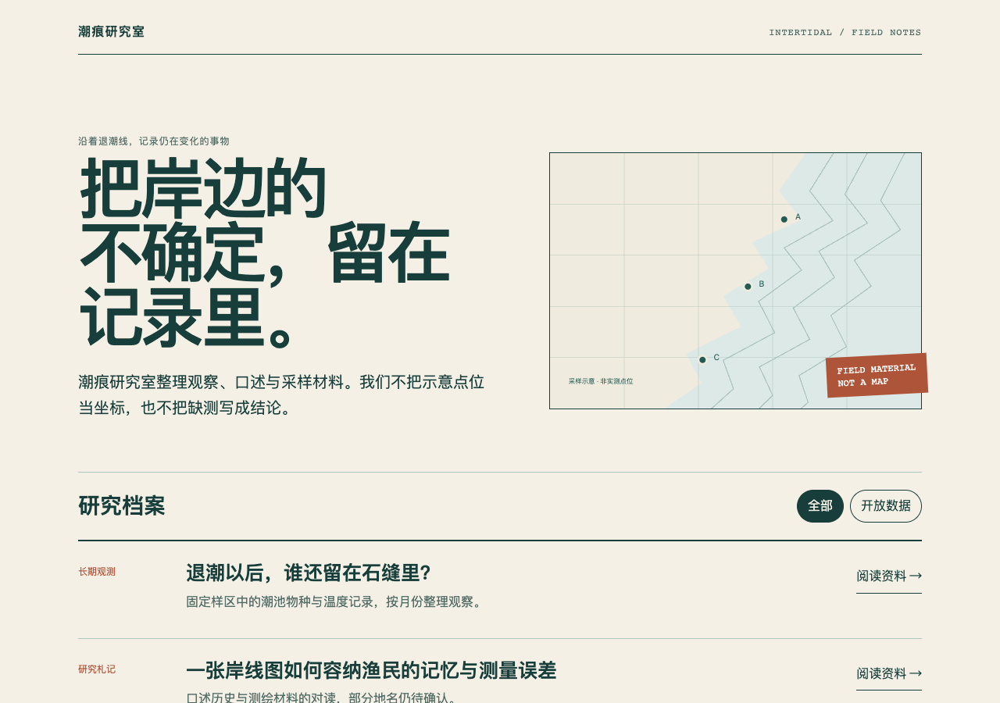
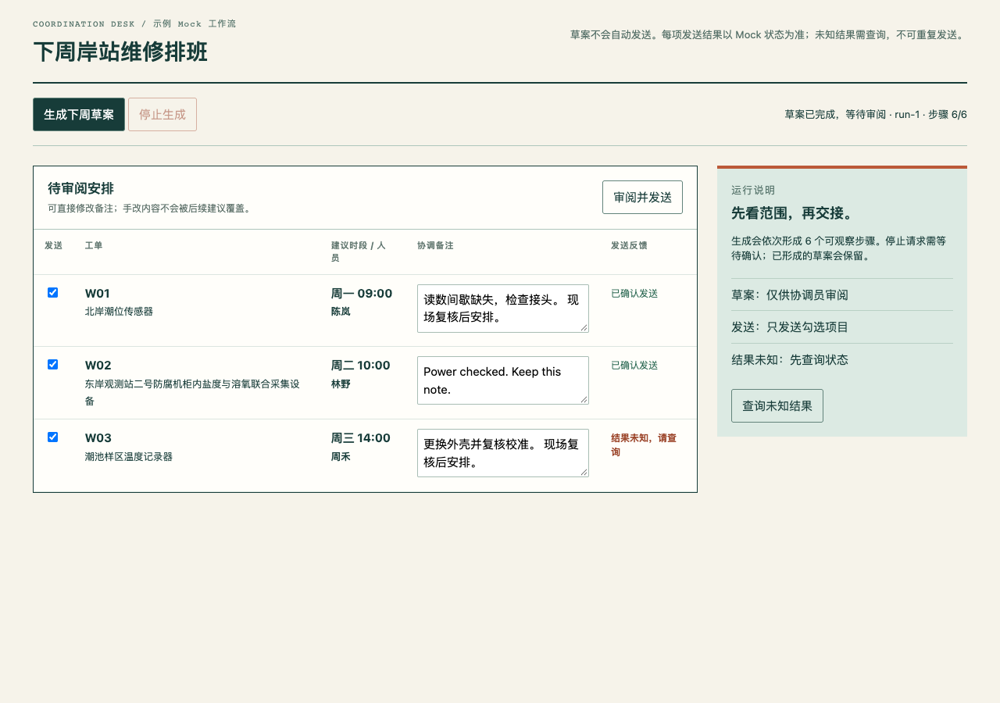

# Yuan-UI-design

[中文](README.md) · [Install](#install-in-codex) · [Try the repair desk](#try-the-repair-desk) · [Design cases](skills/yuan-ui-design/references/visual-case-library.md)

A Codex skill for designing and repairing product interfaces. Give it a product brief or an existing flow that breaks, such as a long device name pushing Save off a phone screen, or an upload timeout leaving the operator unsure whether to retry.



## Install in Codex

Send this line to Codex to install the **2.4.0** skill from a fixed commit:

```text
Use $skill-installer to install https://github.com/n9896027/yuan-ui-design/tree/4aa790d86e4c5e28df10ba43a793c2081aa15bc1/skills/yuan-ui-design
```

Then open your project and try:

```text
$yuan-ui-design Review our work-order editor on a phone. Make sure the full device name and Save are reachable. Trigger a failed save, retry it and tell me which note survives a refresh.
```

For a manual install, copy the `skills/yuan-ui-design` directory from the [2.4.0 snapshot](https://github.com/n9896027/yuan-ui-design/tree/4aa790d86e4c5e28df10ba43a793c2081aa15bc1) into `${CODEX_HOME:-$HOME/.codex}/skills/`. Compare any existing local customizations before replacing them.

## Try the repair desk

Open the [standalone demo file](examples/repair-desk/index.html), choose **Download raw file** on GitHub, and open the HTML in a browser. The demo is in Chinese and uses sample records and browser storage.

1. Edit the note (检修备注) on work order W-02, tick 模拟下一次保存失败 to fail the next save, and click 保存更改 to save.
2. Read the failure message and check that the draft is still visible.
3. Click 保存更改 again. Once the page confirms the save, refresh and check the note on W-02.

To try the repair from scratch, start with the [original broken fixture](skills/yuan-ui-design/evals/fixtures/editor.html).

## A closer look at the cases

**Research website.** Two layouts use the same coastal research material. In the first, the opening illustration pushes the research archive below the fold. The second puts the first research entry and its filter in view. Select either image for the full screenshot.

| Field illustration first | Archive visible on entry |
| --- | --- |
| [](skills/yuan-ui-design/assets/visual-cases/research-entry-late.png) | [](skills/yuan-ui-design/assets/visual-cases/research-entry-visible.png) |

**AI scheduling.** Two assignments have been sent and a third has timed out. The coordinator can inspect the unknown result without resending the completed items. The screenshot comes from a local run with a simulated sending service.

[](skills/yuan-ui-design/assets/visual-cases/agent-partial-results.png)

**Web, native apps and product 3D.** The 2.4 briefs pair a mobile browser inspection with an Android app inspection, and a 3D viewer with a configurator for the same device. Each pair changes one design decision you can test. In the viewer, can someone locate the right connector? In the configurator, can they change the enclosure, correct an incompatible connector, and reopen their saved choice? See the [paired design specifications (Chinese)](docs/platform-and-3d.md).

## Verification and credits

From the repository root, run:

```sh
node scripts/check-repository.mjs
node skills/yuan-ui-design/scripts/validate-ui-evidence.mjs --self-test
node skills/yuan-ui-design/scripts/ui-artifacts.mjs --self-test
```

[Skill entry point](skills/yuan-ui-design/SKILL.md) · [Verification guide](skills/yuan-ui-design/references/verification.md) · [Sources](skills/yuan-ui-design/references/source-manifest.md) · [Huashu Design attribution and upstream license](skills/yuan-ui-design/references/huashu-adaptation.md)
