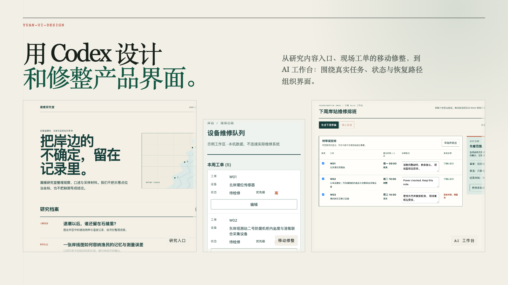
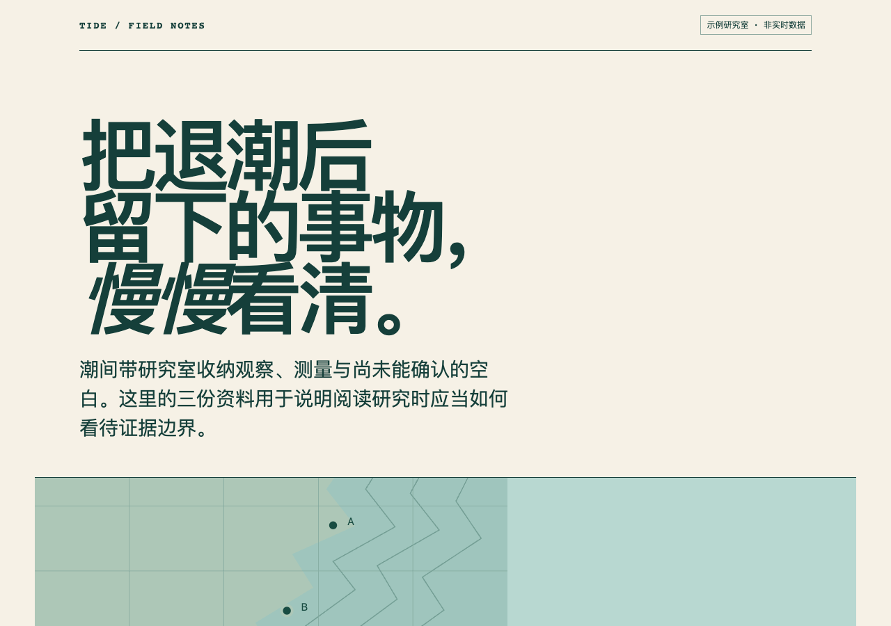
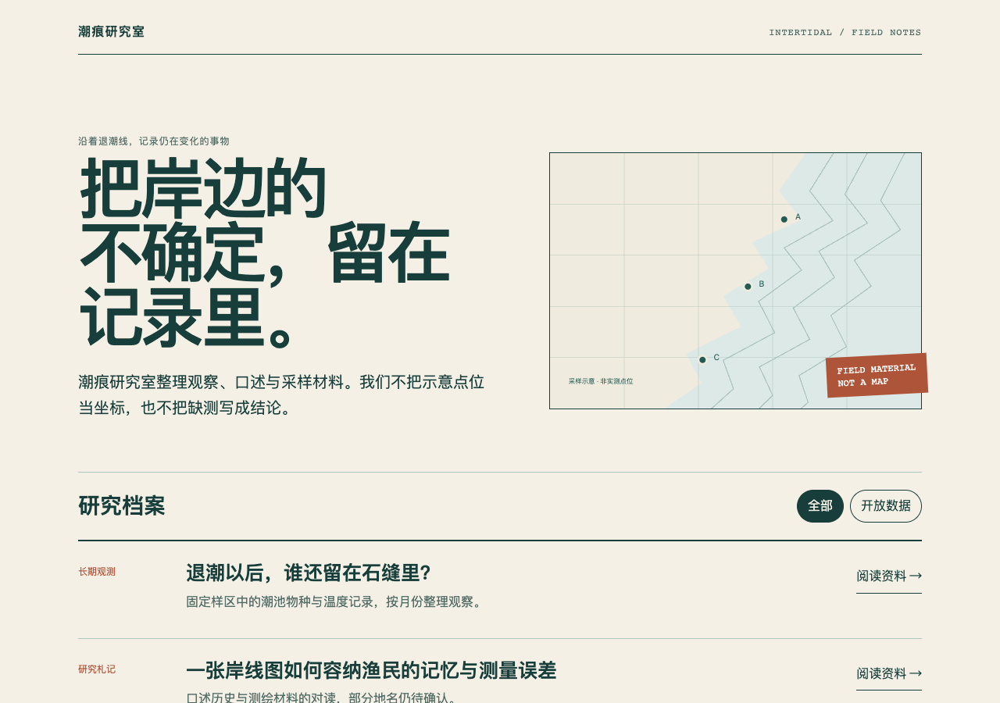
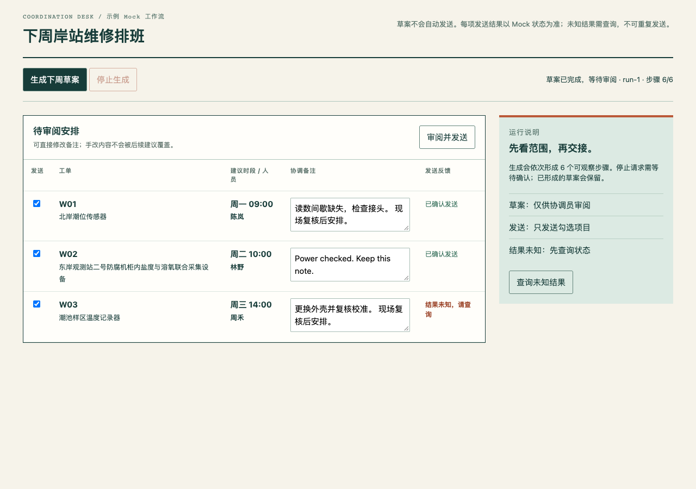

# Yuan-UI-design

[English](README.en.md) · [安装到 Codex](#安装到-codex) · [试用维修台](#试用维修台) · [平台与 3D 设计示例](docs/platform-and-3d.md)

用 Codex 设计和修整产品界面。你可以给它一份需求，也可以直接指出已有产品哪里不好用，例如「手机上的设备名挡住了保存按钮，保存失败后我写的备注也没了」。



## 安装到 Codex

下面的安装链接固定到公开的 **2.4.0**。本开发分支的技能版本是 **2.5.0-dev.3**，可从当前检出目录安装。

```text
请用 $skill-installer 安装 https://github.com/n9896027/yuan-ui-design/tree/4aa790d86e4c5e28df10ba43a793c2081aa15bc1/skills/yuan-ui-design
```

然后在你要修改的项目中试一句：

```text
$yuan-ui-design 检查工单编辑页。手机上要能看清设备全名、编辑备注并保存。请实际试一次保存失败和重试，告诉我刷新后留下的是什么。
```

<details>
<summary>手动安装或检查已安装版本</summary>

下载含技能的分支或[固定版本](https://github.com/n9896027/yuan-ui-design/tree/4aa790d86e4c5e28df10ba43a793c2081aa15bc1)，将其中的 `skills/yuan-ui-design` 文件夹复制到 `${CODEX_HOME:-$HOME/.codex}/skills/`。打开已安装目录里的 `SKILL.md`，固定版本的 `metadata.version` 为 `2.4.0`，本开发分支为 `2.5.0-dev.3`。已有定制版本时，先比较差异，再决定是否替换。

</details>

## 试用 2.5 开发版

克隆或下载整个开发版本后，可在本机打开下面的页面。保留 HTML 旁的资源目录。OpenClaw 已在隔离工作区通过离线发现读取技能名称和说明，完整设计任务尚待跨宿主复验。

| 想验证的能力 | 可以操作的样例 |
| --- | --- |
| 配图是否真能认出接口 | 打开[实物辨认页](examples/device-inspection/index.html)，分别找出 USB-C、HDMI 0 和 HDMI 1。选中标记后核对局部放大图。 |
| 3D 配置是否可撤回 | 打开[接口配置器](examples/port-configurator/index.html)，旋转机壳示意、尝试冲突配件、撤回，再保存并刷新。 |
| 改完一段字幕会不会丢掉另一段 | 打开[字幕编辑器和反例](skills/yuan-ui-design/evals/subtitle-persistence/README.md)，复现保存旧值与迟到回执。 |
| 一个场次能否同步出不同格式 | 查看[节目页](examples/silent-programme/output/programme.html)、[可编辑演示稿](examples/silent-programme/output/programme.pptx)和[微信小程序工程](examples/silent-programme/wechat/README.md)。[整套成品与重建说明](examples/silent-programme/README.md)含三张真实剧照与宣传短片。 |
| 原生 App 怎样保存巡检记录 | 打开 [SwiftUI 巡检工程](examples/native-inspection/README.md)。iOS SDK 已编译出 App 包，真机相机与后台恢复待验。 |

## 配图构图实测

[查看《月球旅行记》社交图的实际裁切变化](examples/silent-programme/moon-comparison.jpg)，或[并排查看与 Huashu 3.5.0 的陌生题首稿](benchmarks/portrait-composition/compare.html)。两位匿名代理都更喜欢 Huashu 对观察点的引导。逐点复核也发现了勋表标错位置和首屏活动信息不足。[简报、两份源稿与评审记录](benchmarks/portrait-composition/README.md)

## 用 Unslop 精修已有界面

在有源码的项目中试一句：「$yuan-ui-design 用 Unslop 检查工单编辑页。重点看手机上的保存失败，保留现有品牌和保存流程，只修能指出的问题。」它会按屏幕证据选择保留、局部修正或整屏调整，并用相同内容和状态复核。

[看同一张工单在桌面、手机和保存失败时的前后对照](benchmarks/unslop-repair-desk/review.html)。

只有网址时，也可以让 Yuan 保存原网页、生成可编辑副本并在离线浏览器里复核。先看字体、图片和动态画面是否保留下来，再做视觉修改。[网址改稿工具的用法](skills/yuan-ui-design/references/unslop.md) · [CERN 页面与离线回归记录](benchmarks/url-baseline/README.md)

改编自 Damir Sokolovsky 的 Unslop，遵循 CC BY 4.0。[技能用法与署名](skills/yuan-ui-design/references/unslop.md) · [原项目](https://github.com/heydamir/unslop)

## 试用维修台

[打开维修台演示文件](examples/repair-desk/index.html)。在 GitHub 文件页选择 **Download raw file**，用浏览器打开下载的 HTML。设备和工单为样例数据。页面底部的「可复现状态」可直接打开长设备名、保存中、失败留稿与保存后重开。

1. 改写工单 W-02 的「检修备注」，勾选「模拟下一次保存失败」，点「保存更改」。
2. 页面会提示保存失败。核对刚才输入的文字是否仍在编辑框。
3. 再点一次「保存更改」。看到「已保存到本机」后刷新，核对 W-02 的备注。

这条流程把两个容易混淆的问题分开了：用户眼前的草稿还在，和浏览器已经保存它。你也可以把[保留原始缺陷的练习文件](skills/yuan-ui-design/evals/fixtures/editor.html)复制到自己的项目，用上面的提示词亲自修一次。

## 两个设计决定，看得见前因后果

### 研究网站：把第一篇研究带回首屏

同一份海岸生态研究材料，两种首页编排。左图先给大标题和岸线图，访客要继续滚动才能找到研究。右图收紧开场，在同样的桌面视口露出研究档案和筛选。点图可查看原始截图。

| 先看场地 | 首屏可以开始找研究 |
| --- | --- |
| [](skills/yuan-ui-design/assets/visual-cases/research-entry-late.png) | [](skills/yuan-ui-design/assets/visual-cases/research-entry-visible.png) |

### AI 排班：发出两条，第三条超时，接下来点什么？

协调员需要看清哪两条已经送达、哪一条还要查。样例把结果放回各自工单，让人只核对那条状态未知的记录。可以用这个问题评审你自己的批量操作界面：用户再点一次，会查询状态，还是把已完成的动作又执行一遍？

[](skills/yuan-ui-design/assets/visual-cases/agent-partial-results.png)

这些画面来自本地评测。排班发送使用模拟服务。截图、交互检查和后续修复各自的范围记录在[案例记录](skills/yuan-ui-design/references/visual-case-library.md)。

## 把它用在哪类任务

| 你的任务 | 可以直接这样问 |
| --- | --- |
| 手机网页与原生 App | 同一张巡检单，从浏览器链接进入和从 Android 系统相机返回，草稿应分别怎样恢复？ |
| 产品 3D | 帮技术员辨认设备背面的接口。模型加载失败时，还能用哪张标注图完成核对？ |
| 配置器 | 换外壳以后，之前选的接口可能不兼容。用户如何撤回，保存后如何继续改？ |
| 已有产品局部修复 | 沿用项目里的表单和保存逻辑，检查长文案、键盘提交、失败留稿与刷新恢复。 |

[看巡检与设备的设计示例](docs/platform-and-3d.md) · [查看完整技能入口](skills/yuan-ui-design/SKILL.md)

## 验证与来源

在仓库根目录运行以下命令，可检查文件链接、样例截图的完整性，及配图来源，并运行编辑器、照片和 3D 的浏览器回归。

```sh
node scripts/check-repository.mjs
node skills/yuan-ui-design/scripts/validate-ui-evidence.mjs --self-test
node skills/yuan-ui-design/scripts/ui-artifacts.mjs --self-test
python3 examples/silent-programme/check.py
npm ci
npx --no-install playwright install chromium
npm run test:editor && npm run test:transfer && npm run test:photo && npm run test:3d
```

[展签首稿与修正对比](benchmarks/exhibit-transfer/README.md) · [原生巡检工程与验证范围](examples/native-inspection/README.md) · [证据如何记录](skills/yuan-ui-design/references/verification.md) · [设计方法与规范来源](skills/yuan-ui-design/references/source-manifest.md) · [Huashu Design 的方法借鉴与上游许可](skills/yuan-ui-design/references/huashu-adaptation.md)
